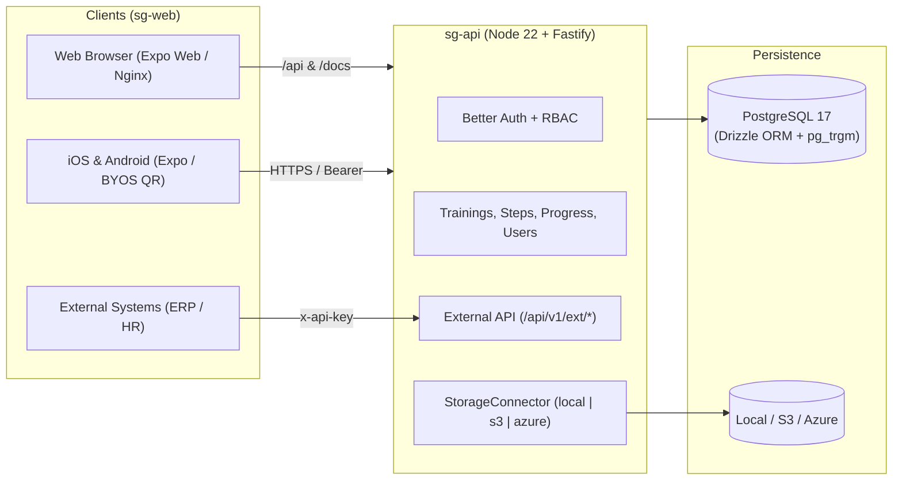

<div align="center">

# Smart Guide

**Open-source, self-hosted platform for step-by-step corporate trainings, visual SOPs, and guided onboarding.**

[](https://opensource.org/licenses/MIT)
[](https://nodejs.org/)
[](https://www.postgresql.org/)
[](https://expo.dev/)
[](https://docs.docker.com/compose/)
[](./sg-web/src/i18n/locales)

[Quickstart](#-quickstart-docker) •
[Architecture](#-architecture) •
[Features](#-key-features) •
[Documentation](#-documentation) •
[Backup & Restore](#-backup--restore)

</div>

---

## Overview

**Smart Guide** is a single-tenant, self-hosted training and documentation platform built for teams that want full ownership of their data, media, and authentication.

Create structured step-by-step guides with rich text, images, and videos; export sanitized PDF manuals; authenticate via Email/Password, Google, or Microsoft Entra ID; and pair mobile devices in seconds via QR Code.

---

## Key Features

| Area | Capabilities |
| :--- | :--- |
| **Authoring & Player** | Step-by-step training builder, XSS-sanitized rich text editor, transactional step & attachment reordering, progress tracking |
| **Pluggable Storage (BYOS)** | **Local Disk**, **S3-compatible** (AWS S3, MinIO, Cloudflare R2, DigitalOcean Spaces), or **Azure Blob Storage** with HTTP `Range` (`206 Partial Content`) video streaming |
| **Authentication & RBAC** | [Better Auth](https://www.better-auth.com/) with Email/Password, **Google OAuth**, **Microsoft Entra ID**, mobile deep-link OAuth bridge, and `admin` / `creator` / `user` roles |
| **Security Hardening** | Magic-byte upload validation (`.svg` & executables blocked), `X-Content-Type-Options: nosniff`, Helmet, strict CORS, rate limiting, and `SHA-256` scoped API keys (`x-api-key`) |
| **Offline & PDF** | Sanitized PDF manual export and authenticated offline training/media download on mobile |
| **Multilingual (`i18n`)** | Full UI, API error mapping, PDF labels, and user guides in **`pt-BR`**, **`en`**, and **`es`** |
| **API & Integrations** | Self-hosted Swagger UI at `/docs` and scoped External API (`/api/v1/ext/*`) for HR/ERP integrations |

---

## Architecture



---

## Quickstart (Docker)

### 1. Configure environment

```bash
cp .env.example .env
```

Edit `.env` and set strong values for at least:
- `POSTGRES_PASSWORD`
- `BETTER_AUTH_SECRET` (generate with `openssl rand -hex 32`)
- `SEED_ADMIN_EMAIL` and `SEED_ADMIN_PASSWORD`

### 2. Start the stack

```bash
docker compose up -d --build
```

> **Optional S3-compatible storage (MinIO):** start with `docker compose --profile s3 up -d --build` and set `STORAGE_DRIVER=s3` in `.env`.

### 3. Access

- **Web App:** `http://localhost:8080` (or `WEB_PORT` in `.env`)
- **Swagger UI:** `http://localhost:8080/docs`
- **Healthcheck:** `http://localhost:8080/health`

On first boot, `sg-api` automatically runs PostgreSQL migrations (with advisory locking) and seeds the initial admin user idempotently.

---

## Local Development

### Backend (`sg-api`)

```bash
cd sg-api
npm install
npm run dev
```

Run tests, linter, and typecheck:

```bash
cd sg-api
npm test && npm run lint && npx tsc --noEmit
```

### Frontend (`sg-web`)

```bash
cd sg-web
npm install
npx expo start --web
```

Run typecheck, linter, and static web export:

```bash
cd sg-web
npx tsc --noEmit && npx expo lint && npx expo export --platform web
```

---

## Backup & Restore

PostgreSQL backup and restore scripts are included in `docker/scripts/`:

```bash
# Create compressed backup in ./backups/
./docker/scripts/backup-postgres.sh

# Restore from a backup file
./docker/scripts/restore-postgres.sh ./backups/smart-guide-smart_guide-YYYYMMDDTHHMMSSZ.sql.gz
```

---

## Documentation

### User & Admin Guides

| Language | Getting Started | Admin Guide | Creator Guide | Learner & Mobile |
| :--- | :--- | :--- | :--- | :--- |
| **Português (BR)** | [getting-started.md](./docs/guides/pt-BR/getting-started.md) | [admin-guide.md](./docs/guides/pt-BR/admin-guide.md) | [creator-guide.md](./docs/guides/pt-BR/creator-guide.md) | [learner-mobile-guide.md](./docs/guides/pt-BR/learner-mobile-guide.md) |
| **English** | [getting-started.md](./docs/guides/en/getting-started.md) | [admin-guide.md](./docs/guides/en/admin-guide.md) | [creator-guide.md](./docs/guides/en/creator-guide.md) | [learner-mobile-guide.md](./docs/guides/en/learner-mobile-guide.md) |
| **Español** | [getting-started.md](./docs/guides/es/getting-started.md) | [admin-guide.md](./docs/guides/es/admin-guide.md) | [creator-guide.md](./docs/guides/es/creator-guide.md) | [learner-mobile-guide.md](./docs/guides/es/learner-mobile-guide.md) |

### System Reference

- [System Architecture](./docs/system/architecture.md)
- [Database Schema & ER Diagram](./docs/system/database-schema.md)
- [Authentication & Authorization](./docs/system/authentication.md)
- [Storage Connectors (`local`, `s3`, `azure`)](./docs/system/storage-connectors.md)
- [Security Controls](./docs/system/security.md)
- [REST & External API Reference](./docs/system/api-reference.md)

---

## Repository Structure

```text
.
├── docker/
│   ├── nginx/sg-web.conf          # SPA + /api & /docs reverse proxy
│   └── scripts/                   # PostgreSQL backup & restore scripts
├── docs/
│   ├── guides/{pt-BR,en,es}/      # Multilingual platform guides
│   └── system/                    # Architecture, schema & security docs
├── sg-api/                        # Node 22 + Fastify + Drizzle + Postgres + Better Auth
├── sg-web/                        # Expo (Web + iOS + Android) universal client
├── .env.example                   # Global configuration template
└── docker-compose.yml             # Self-hosted stack (postgres, sg-api, sg-web, optional minio)
```

---

## License

Released under the **MIT License**.
