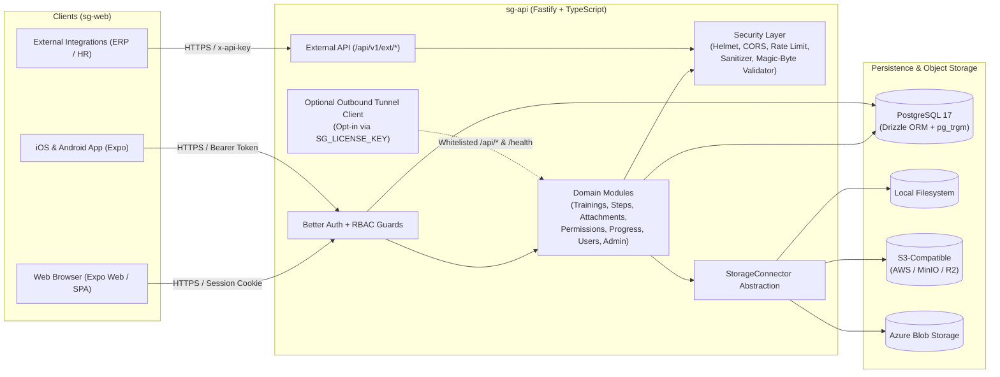
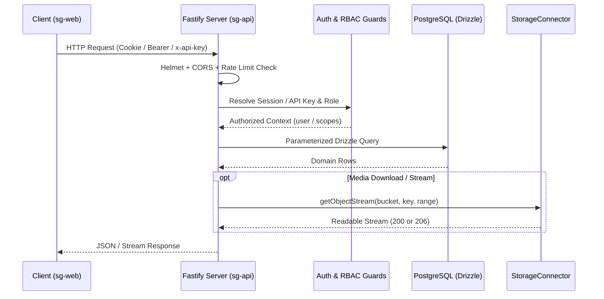

# System Architecture

Smart Guide is designed as a modular, self-hosted monorepo separating the backend API (`sg-api`) from the universal frontend (`sg-web`).

## High-Level Architecture

---

## Core Components

### 1. Backend (`sg-api`)

- **Framework:** Fastify 5 with TypeScript (`ESM`), Zod schema validation, and `@fastify/swagger` + `@fastify/swagger-ui` (`/docs`).
- **Database Layer:** PostgreSQL accessed via `pg` connection pool and **Drizzle ORM** (`sg-api/src/db/`). SQL migrations live in `sg-api/drizzle/`.
- **Authentication:** **Better Auth** (`sg-api/src/auth/auth.ts`) backed by PostgreSQL tables (`user`, `session`, `account`, `verification`), supporting Email/Password, Google OAuth, and Microsoft Entra ID.
- **Storage Connectors:** Pluggable `StorageConnector` interface (`sg-api/src/storage/types.ts`) supporting `local`, `s3`, and `azure` drivers with HTTP `Range` streaming (`206 Partial Content`) for video playback.
- **Security Pipeline:** Strict CORS allowlist, Helmet CSP headers, tiered rate limiting, server-side HTML sanitization (`sanitize-html`), file magic-byte validation (`file-type`), and SHA-256 hashed API keys.
- **Outbound Tunnel Client (Opt-in):** `sg-api/src/tunnel/client.ts` only starts when both `SG_LICENSE_KEY` and `SG_CLOUD_RELAY_URL` are explicitly configured. It strictly forwards whitelisted HTTP paths (`/health`, `/api/auth/*`, `/api/v1/*`) using Fastify's in-process `app.inject()` without exposing the host OS or database.

### 2. Universal Frontend (`sg-web`)

- **Framework:** Expo SDK + Expo Router (`src/app/`) targeting Web, iOS, and Android from a single codebase.
- **Authentication & State:** `AuthContext` manages session tokens/cookies and user roles (`admin`, `creator`, `user`), while `serverConfig.service.ts` supports BYOS (Bring Your Own Server) connection via URL or QR code on mobile.
- **Internationalization (`i18n`):** `i18next` + `react-i18next` with bundled translations for `pt-BR`, `en`, and `es` (`src/i18n/locales/*.json`), synchronized with user profile preferences (`preferred_locale`) and instance defaults (`default_locale`).
- **Offline & PDF:** `offline.service.ts` caches training metadata, steps, and media attachments on the device; `pdf.service.ts` generates sanitized, localized multi-page PDF documents.

---

## Request Lifecycle

---

## Related Documentation

- [Database Schema & ER Diagram](./database-schema.md)
- [Authentication & Authorization](./authentication.md)
- [Storage Connectors](./storage-connectors.md)
- [Security Controls](./security.md)
- [REST & External API Reference](./api-reference.md)
