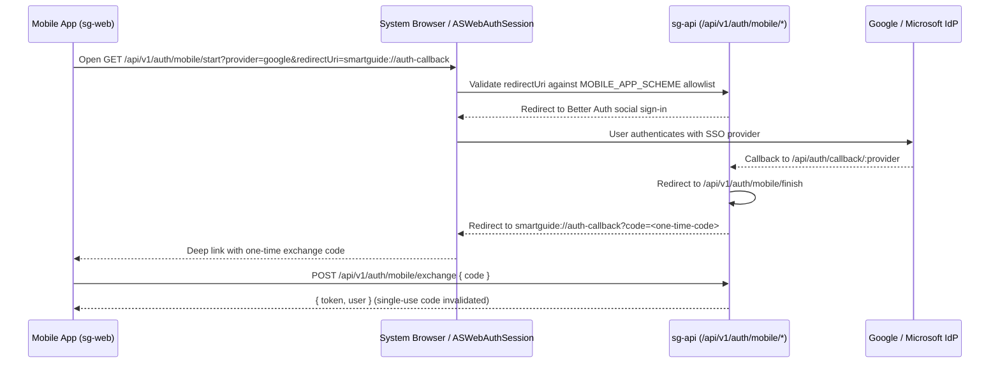

# Authentication & Authorization

Smart Guide uses **Better Auth** (`sg-api/src/auth/auth.ts`) for authentication and a two-layer authorization model combining **global user roles** with **per-training access control lists (ACL)**.

---

## Supported Authentication Providers

| Provider | Environment Variables | Notes |
| :--- | :--- | :--- |
| **Email & Password** | `AUTH_ALLOW_EMAIL_PASSWORD`, `AUTH_ALLOW_PUBLIC_SIGNUP` | Public self-registration is disabled (`false`) by default; admins create or invite users. |
| **Google OAuth** | `GOOGLE_CLIENT_ID`, `GOOGLE_CLIENT_SECRET` | Enabled automatically when both variables are populated. |
| **Microsoft Entra ID** | `MICROSOFT_CLIENT_ID`, `MICROSOFT_CLIENT_SECRET`, `MICROSOFT_TENANT_ID` | Supports `common`, `organizations`, or a specific tenant GUID. |

Sessions are persisted in PostgreSQL (`session` table) and accepted via HTTP-only cookies (Web) or `Authorization: Bearer <token>` (Mobile / API clients). Inactive users (`isActive = false`) are blocked by auth guards (`403`).

---

## Mobile OAuth Flow (Deep-Link Allowlist)

Native mobile apps cannot receive standard browser session cookies directly from OAuth callbacks. `sg-api/src/auth/mobile-oauth.ts` implements a hardened OAuth relay with an explicit redirect scheme allowlist (`MOBILE_APP_SCHEME`, default `smartguide`):

---

## Authorization Model (RBAC + Per-Training ACL)

### 1. Global User Roles (`user.role`)

| Role | Capabilities |
| :--- | :--- |
| `admin` | Full instance control: manage users, roles, categories, API keys, instance settings, and all trainings. |
| `creator` | Create new trainings, manage trainings they created or own, and share access with collaborators. |
| `user` | Browse published public trainings and private trainings explicitly shared with them; track personal step progress. |

### 2. Per-Training Permissions (`training_permissions.permission`)

Evaluated by `sg-api/src/auth/permissions.ts`:

| Level | View Training | Edit Details & Steps | Share / Delete Training |
| :--- | :---: | :---: | :---: |
| `viewer` | Yes | No | No |
| `editor` | Yes | Yes | No |
| `owner` | Yes | Yes | Yes |

The original creator (`trainings.created_by`) and global `admin` users retain full management rights over a training, and the original creator's permission cannot be removed.

---

## Initial Admin Seeding

On startup (or via `npm run db:seed`), `sg-api/src/db/seed.ts` checks if any `admin` user exists. If none is found, it creates the initial admin account using `SEED_ADMIN_EMAIL`, `SEED_ADMIN_PASSWORD`, and `SEED_ADMIN_NAME` idempotently.
