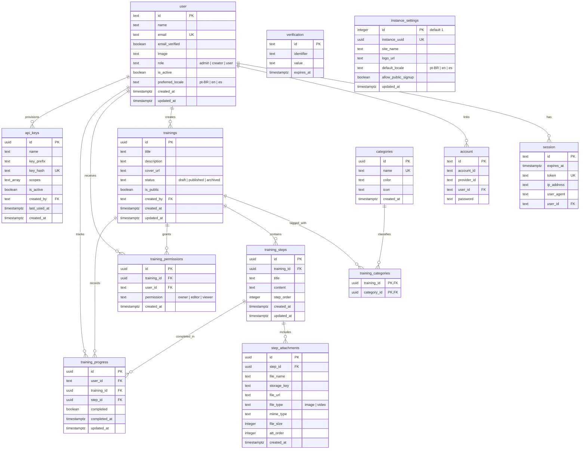

# Database Schema & ER Diagram

Smart Guide uses **PostgreSQL** managed through **Drizzle ORM** (`sg-api/src/db/schema/`). Migrations are stored in `sg-api/drizzle/` and executed via `npm run db:migrate`.

---

## Entity-Relationship Diagram

---

## Tables & Indexing Summary

### Authentication Tables (`sg-api/src/db/schema/auth.ts`)

| Table | Purpose | Key Constraints / Indexes |
| :--- | :--- | :--- |
| `user` | User accounts, global roles (`admin`, `creator`, `user`), active flag, and `preferred_locale`. | `email` unique |
| `session` | Active Better Auth sessions with expiration, IP, and User-Agent metadata. | `token` unique; `session_user_id_idx` on `user_id`; cascades on user delete |
| `account` | OAuth provider links (Google, Microsoft) and hashed email/password credentials. | `account_user_id_idx` on `user_id`; cascades on user delete |
| `verification` | Verification/state tokens used by Better Auth flows. | `verification_identifier_idx` on `identifier` |

### Core Domain Tables (`sg-api/src/db/schema/core.ts`)

| Table | Purpose | Key Constraints / Indexes |
| :--- | :--- | :--- |
| `instance_settings` | Singleton (`id = 1`) holding `instance_uuid`, `site_name`, `logo_url`, `default_locale`, and `allow_public_signup`. | `instance_uuid` unique |
| `categories` | Training taxonomy tags with hex `color` and optional `icon`. | `name` unique |
| `trainings` | Training guides (`draft`, `published`, `archived`), visibility (`is_public`), and creator reference. | `trainings_created_by_idx`, `trainings_status_public_idx`; `created_by` uses `ON DELETE RESTRICT` |
| `training_categories` | Many-to-many join between `trainings` and `categories`. | Composite PK `(training_id, category_id)`; `training_categories_category_id_idx` |
| `training_steps` | Ordered steps belonging to a training with sanitized HTML `content`. | `training_steps_training_order_idx` on `(training_id, step_order)` |
| `step_attachments` | Media metadata (`image` / `video`, `storage_key`, `mime_type`, `file_size`, `att_order`). | `step_attachments_step_order_idx` on `(step_id, att_order)` |
| `training_permissions` | Per-training collaboration ACL (`owner`, `editor`, `viewer`). | Unique `(training_id, user_id)`; `training_permissions_user_id_idx` |
| `training_progress` | Per-user step completion tracking (`completed`, `completed_at`). | Unique `(user_id, step_id)`; `training_progress_user_training_idx` |
| `api_keys` | Hashed API keys (`key_prefix` + SHA-256 `key_hash`) and `scopes` (`users:read`, `users:write`, `trainings:read`). | `key_hash` unique; `created_by` uses `ON DELETE SET NULL` |

---

## Full-Text / Trigram Search (`pg_trgm`)

Migration `0001_enable_pg_trgm_search.sql` enables the PostgreSQL `pg_trgm` extension so catalog and user search queries stay responsive as the dataset grows.
