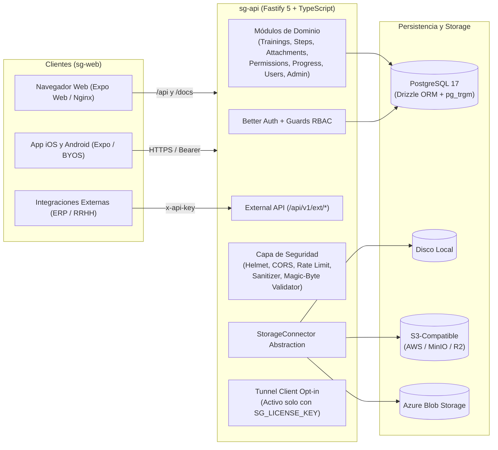

# Arquitectura del Sistema

**Smart Guide** es un monorepo modular y auto-hospedado que separa la API REST (`sg-api`) del cliente universal (`sg-web`), operando en modelo **single-tenant** con PostgreSQL 17.

## Visión General

## Documentos Relacionados

- [Modelo de Base de Datos y Diagrama ER](../database-schema/)
- [Autenticación y Autorización](../authentication/)
- [Conectores de Almacenamiento](../storage-connectors/)
- [Controles de Seguridad](../security/)
- [Referencia de API REST y Externa](../api-reference/)
