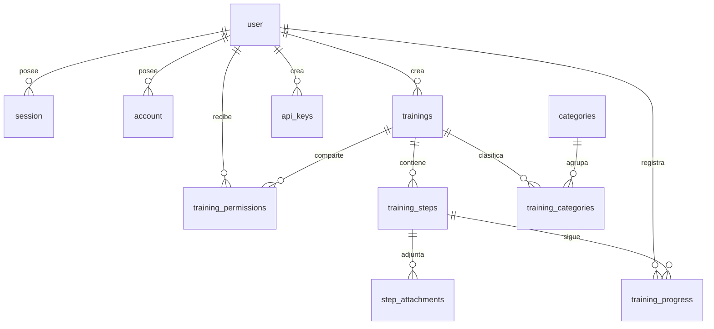

# Modelo de Base de Datos y Diagrama ER

Smart Guide utiliza **PostgreSQL 17** con **Drizzle ORM** en arquitectura **single-tenant**.

## Diagrama Entidad-Relación

## Tablas Principales

- **Autenticación (Better Auth):** `user` (`role`: `'admin'|'creator'|'user'`, `isActive`, `preferredLocale`), `session`, `account`, `verification`.
- **Configuración:** `instance_settings` (singleton `id = 1` con `instanceUuid`, `siteName`, `logoUrl`, `defaultLocale`, `allowPublicSignup`).
- **Contenido:** `categories`, `trainings` (índice GIN `pg_trgm` en `title`), `training_categories`, `training_steps` (`stepOrder` transaccional) y `step_attachments` (`storageKey`, `fileType`, `mimeType`, `fileSize`, `attOrder`).
- **Control e Integración:** `training_permissions` (`'owner'|'editor'|'viewer'`), `training_progress` (`UNIQUE(userId, stepId)`) y `api_keys` (`keyPrefix`, `keyHash` SHA-256 único, `scopes`, `isActive`).
