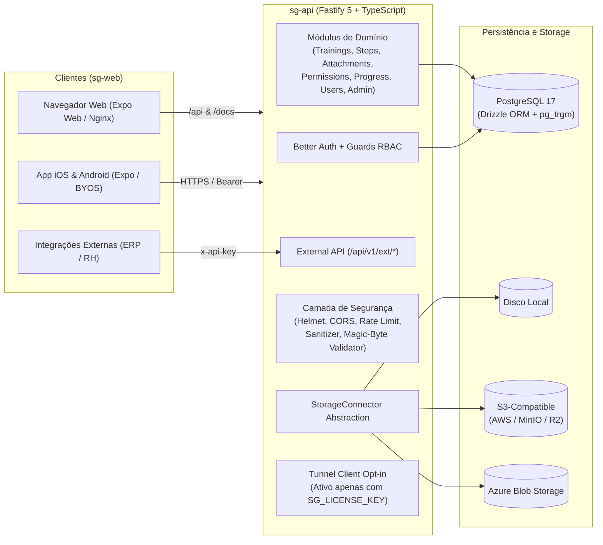

# Arquitetura do Sistema

O **Smart Guide** é um monorepo modular e auto-hospedado que separa a API REST (`sg-api`) do cliente universal (`sg-web`), operando em modelo **single-tenant** com PostgreSQL 17.

## Visão Geral

## Responsabilidades dos Serviços

- **`sg-api` (Node.js 22 + Fastify 5):**
  - Executa migrações Drizzle com `pg_advisory_lock` na inicialização, evitando corrida entre réplicas.
  - Realiza seed idempotente do `instanceSettings` (gerando `instanceUuid` persistente) e do usuário `admin` inicial.
  - Expõe Swagger UI auto-hospedado em `/docs` sem dependência de CDNs externos.
- **`sg-web` (Expo SDK 57 + Expo Router):**
  - No navegador, é compilado como SPA estática servida pelo Nginx (`public/docker/nginx/sg-web.conf`), que faz proxy de `/api/*`, `/docs` e `/health` para `sg-api`.
  - No mobile nativo (iOS/Android), conecta-se a qualquer instância via URL ou QR Code (BYOS), armazenando token Bearer e conteúdos offline.

## Documentos Relacionados

- [Modelo de Banco de Dados e Diagrama ER](../database-schema/)
- [Autenticação e Autorização](../authentication/)
- [Conectores de Storage](../storage-connectors/)
- [Controles de Segurança](../security/)
- [Referência da API REST e Externa](../api-reference/)
