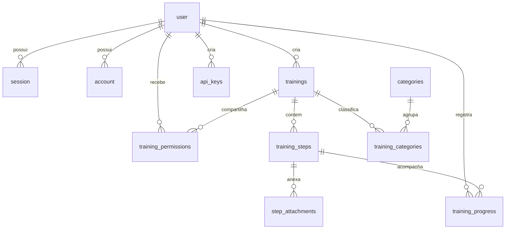

# Modelo de Banco de Dados e Diagrama ER

O Smart Guide utiliza **PostgreSQL 17** com **Drizzle ORM** em arquitetura **single-tenant** (sem tabelas de empresas ou isolamento multi-tenant).

## Diagrama Entidade-Relacionamento

## Principais Tabelas

- **Autenticação (Better Auth):** `user` (`id`, `name`, `email`, `role` `'admin'|'creator'|'user'`, `isActive`, `preferredLocale`), `session`, `account`, `verification`.
- **Configuração da Instância:** `instance_settings` (singleton `id = 1` com `instanceUuid`, `siteName`, `logoUrl`, `defaultLocale`, `allowPublicSignup`).
- **Conteúdo:** `categories`, `trainings` (com índice GIN `pg_trgm` em `title` para busca rápida), `training_categories`, `training_steps` (`stepOrder` transacional) e `step_attachments` (`storageKey`, `fileType` `'image'|'video'`, `mimeType`, `fileSize`, `attOrder`).
- **Controle e Integração:** `training_permissions` (`'owner'|'editor'|'viewer'`), `training_progress` (`UNIQUE(userId, stepId)`) e `api_keys` (`keyPrefix`, `keyHash` SHA-256 único, `scopes`, `isActive`).
