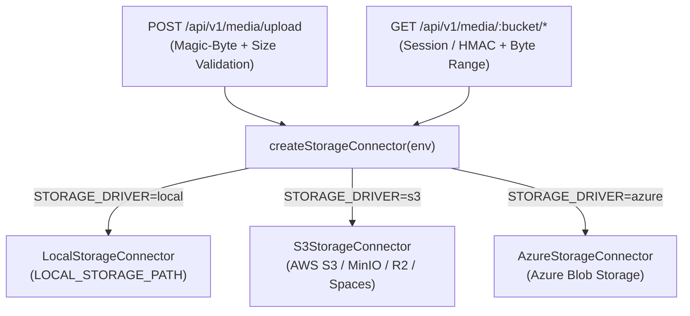

# Storage Connectors

Smart Guide abstracts all binary media storage behind the `StorageConnector` interface (`sg-api/src/storage/types.ts`), allowing instances to switch between local disk, S3-compatible object storage, and Azure Blob Storage via `STORAGE_DRIVER`.

---

## Connector Architecture

### `StorageConnector` Interface

Every connector implements:

- `putObject({ bucket, key, body, contentType, contentLength })`
- `getObjectStream(bucket, key, range?)` — supports HTTP `Range` requests returning `206 Partial Content` with `Content-Range`, `Accept-Ranges`, and `Content-Length`
- `headObject(bucket, key)`
- `deleteObject(bucket, key)` / `deleteObjects(bucket, keys)`
- `healthcheck()` — used by `GET /health`

### Logical Buckets

| Bucket | Contents |
| :--- | :--- |
| `training-covers` | Training cover images |
| `step-attachments` | Step images and videos |
| `instance-assets` | Instance branding assets (custom logo) |

---

## Supported Drivers

### 1. Local Disk (`STORAGE_DRIVER=local`)

- **Implementation:** `sg-api/src/storage/local.connector.ts`
- **Configuration:** `LOCAL_STORAGE_PATH=./uploads`
- **Notes:** Enforces strict path traversal protection (`path.resolve` containment check) so keys cannot escape the configured storage root. Suitable for single-node Docker deployments with a persistent volume.

### 2. S3-Compatible (`STORAGE_DRIVER=s3`)

- **Implementation:** `sg-api/src/storage/s3.connector.ts`
- **Configuration:**
  - `S3_ENDPOINT` (leave empty for AWS S3, or set URL for MinIO, Cloudflare R2, DigitalOcean Spaces)
  - `S3_REGION` (default `us-east-1`)
  - `S3_BUCKET` (default `smart-guide-media`)
  - `S3_ACCESS_KEY_ID` / `S3_SECRET_ACCESS_KEY`
  - `S3_FORCE_PATH_STYLE` (`true` for MinIO / self-hosted S3)

### 3. Azure Blob Storage (`STORAGE_DRIVER=azure`)

- **Implementation:** `sg-api/src/storage/azure.connector.ts`
- **Configuration:**
  - `AZURE_STORAGE_CONNECTION_STRING`, **or** `AZURE_STORAGE_ACCOUNT_NAME` + `AZURE_STORAGE_ACCOUNT_KEY`
  - `AZURE_STORAGE_CONTAINER` (default `smart-guide-media`)

---

## Access Control & Media Streaming

- When `STORAGE_PUBLIC_MEDIA=false` (recommended default), `GET /api/v1/media/:bucket/*` requires either:
  1. An authenticated Better Auth session (cookie or Bearer token), **or**
  2. A short-lived HMAC signature (`?sig=...&exp=...`) minted by `sg-api` so native `<video>` / `<Image>` tags and PDF generators can fetch media securely without exposing raw bucket credentials.
- Upload limits are enforced via `STORAGE_MAX_IMAGE_MB` (default `10`) and `STORAGE_MAX_VIDEO_MB` (default `150`).
